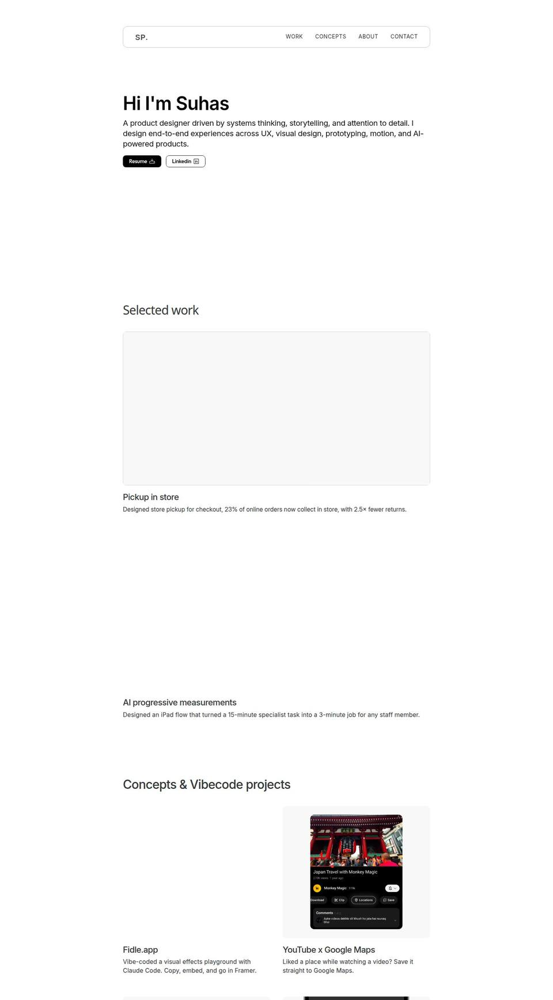

# 01 — Audit of the current site

**Site:** https://suhaspaunikar.framer.website (Framer project "Suhas Portfolio", published, 0 unpublished changes on 2 Nov 2026)
**Method:** Read the live Framer project directly (pages, copy, components, styles) and captured canvas screenshots of every page. The site itself could not be loaded in a browser from this environment (network policy), so visual notes come from the Framer canvas.

---

## What's there today

| Page | Path | Notes |
|---|---|---|
| Home | `/` | Hero ("Hi I'm Suhas") with an embedded **interactive ASCII background**, Resume + LinkedIn buttons → *Selected work* (2 video tiles) → *Concepts & Vibecode projects* (5 tiles) → *Journey* table (7 rows) → footer (mail + socials) |
| Pickup in store | `/bopis` | ~12,600px long case study |
| AI progressive measurements | `/progressive-measurements` | ~12,600px long case study |
| Old home | `/old-home` | Previous version, still published at a public URL |

- **Type:** Inter + Outfit. **Colour:** two tokens, black and white, plus light-grey cards.
- **Components:** Floating pill navigation, Hover Ticker, Liquid Glass (code), circular and "progressive smear" carousels, Hover Card, Video, Phosphor icons.
- **Site metadata:** title "Suhas Portfolio"; **no meta description and no social/OG image** set at site level.
- **Taste signals in your Framer workspace:** you've remixed *Liquid Glass*, *Interactive ASCII* (twice), *Stacking Cards Scroll*, *Frame Reveal* (twice), *Arrow Dynamics*, plus a few agency templates. You clearly like visual effects. Fidle.app, your own vibe-coded effects playground, says the same thing.

---

## What's working (keep this)

1. **Real, quantified outcomes.** "23 in 100 online orders now picked up in store", "2.5× fewer returns", "+20 NPS", "70% faster (15–20 min → 3–5 min)", "live in every Lenskart store in India". Most portfolios don't have numbers this good.
2. **Honest storytelling about failure.** The BOPIS story includes the V1 test that *dropped checkout conversion by 10%* and how you diagnosed it. Showing judgment under pressure is exactly what 2026 reviewers say they look for (see `02-hiring-insights.md`).
3. **AI work with a mature framing.** In the progressive-measurements project, manual measurement stays the source of truth at 85% AI–manual parity, and every paired capture becomes training data. That's a strong human-in-the-loop story, and few designers have one.
4. **Range.** Shipped retail/omnichannel work, product concepts (Swiggy, CRED, Noon, YouTube × Maps), and a vibe-coded tool (Fidle.app) built with Claude Code. That's the "designer who builds" signal hiring managers are asking for.
5. **A genuinely unusual backstory.** Video editor for Netflix, Prime and Zakir Khan → founded a Saoji cloud kitchen → UX designer → product designer at India's largest eyewear retailer. That's a story people remember.

---

## What's holding it back

### 1. The first 10 seconds say nothing specific
Reviewers give a homepage roughly **10–15 seconds** and a portfolio about **55 seconds** on average (sources in `02-hiring-insights.md`). Today the hero is:

> "Hi I'm Suhas. A product designer driven by systems thinking, storytelling, and attention to detail. I design end-to-end experiences across UX, visual design, prototyping, motion, and AI-powered products."

- Nothing in it is unique to you. Any product designer could write every word.
- No specialism (checkout? retail? in-store tools? AI?), no proof (none of your numbers), no hook (none of your story).
- Your **old bio was stronger**: *"Product designer crafting end-to-end journeys where the flow does the storytelling. 4+ years across retail, POS, and omnichannel. Earlier, I edited videos for Netflix, Prime and Zakir Khan."* The new one dropped every specific detail.

### 2. It looks like a template, and you can't own it
- Inter + black/white + light-grey cards + pill nav is the default Framer portfolio look. One review of 100 recent mid-to-head product-designer portfolios found **36% were built on Framer**, more than any other tool. Plain Inter-style grotesks now read as the default (2026 type roundups).
- The ASCII hero background is a nice touch, but it's decoration. It doesn't connect to you or your work.

### 3. The story is buried in a table
"Journey" shows seven rows of company / role / date. Your most memorable material (editing for Netflix, Prime and Zakir Khan; running a cloud kitchen) reads like CV filler.
- Small consistency bug: row 1 is *role · company* ("Product Designer · Lenskart"), but every other row is *company · role* ("Ting · Freelance"). "Ting" appears twice with no context.

### 4. Hierarchy flattens shipped work and concepts
- Two shipped, high-impact projects get the same visual weight as five speculative concepts.
- "Concepts & Vibecode projects" mixes two different things: unsolicited concepts and tools you actually built and shipped. Fidle.app deserves its own billing.

### 5. Case studies are long and dense
- Each is ~12,600px of mostly text. **"Overly long or dense content" is a top red flag for 42% of hiring managers** in the 2026 survey data.
- There's no 30-second version: no TL;DR, no "my role in one line", no jump links.
- Several sentences read as run-ons where punctuation seems to have been stripped. Examples: *"Store pickup wasn't a convenience play it was a margin lever."* and *"beyond delivery a quick frame adjustment, a fit check…"*. If you removed em dashes to avoid looking AI-written, use a period or colon instead. Don't leave nothing.
- There are no interactive moments, even though both projects have highly "playable" mechanics (the V1→V2 cart widget, the pupil-marker alignment with a zoom loupe).

### 6. Craft nits (they matter because your bio says "attention to detail")
- "Hi I'm Suhas" → "Hi, I'm Suhas"; "Linkedin" → "LinkedIn"; "Pickup in store for lenskart" → "Lenskart"; "2.5 X" → "2.5×"; "Vibecode" vs "Vibe-coded" used inconsistently.
- `/old-home` is still published at a public URL.
- No meta description or OG image. Links shared on LinkedIn/WhatsApp/Slack get a bare card.
- The site sits on a `*.framer.website` subdomain. A custom domain is cheap and reads more senior.
- Video tiles: make sure they all have **poster frames**. On slow mobile data, the first thing a visitor sees is an empty grey box (that's also how they render in canvas screenshots).

### 7. Missing pieces reviewers look for
- Availability, location, and the role you want next.
- Social proof (one or two quotes from PMs or engineers you worked with).
- A clear contact call to action beyond the footer email.
- An About page. The nav says "About", but there's no page behind it.

---

## Bottom line
The **content** is above average: real numbers, honest iteration, AI with humans in charge, an unusual backstory. The **container** is below average: generic, template-shaped, dense. The redesign should not change what you say so much as **how fast people hear it and how much they remember**.
